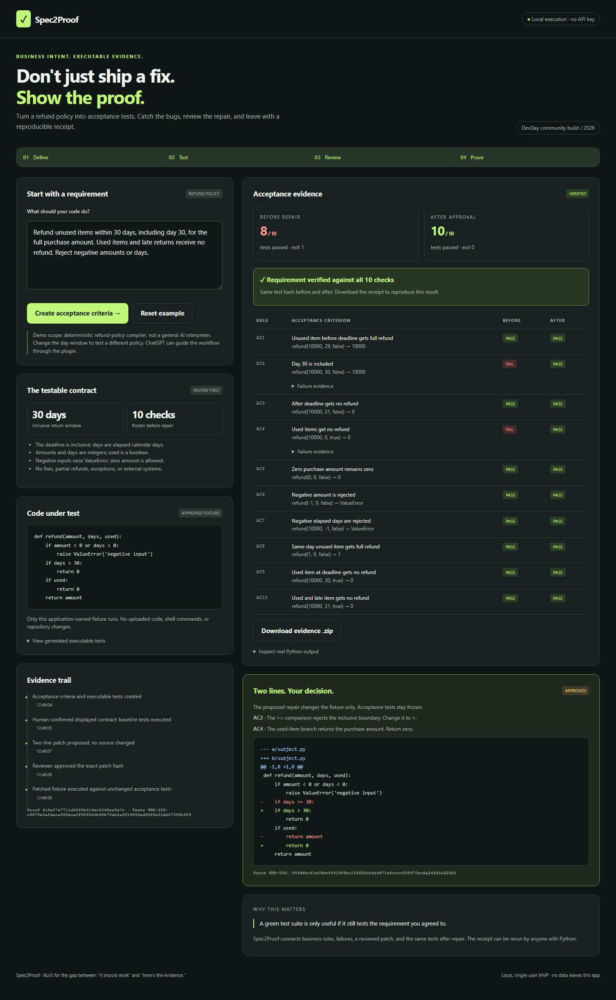

# Spec2Proof

**Business intent → executable tests → reviewed repair → reproducible evidence.**

Spec2Proof helps a product owner and developer agree on what “fixed” means. Start with a refund requirement, inspect ten acceptance criteria, run them against deliberately buggy Python, review a two-line repair, approve it, and rerun the **same tests**. Export a receipt that another person can reproduce.

Built as a three-hour community hackathon MVP for October 10, 2026. No API key, paid service, package installation, or deployment is needed for the core demo.

[](https://www.youtube.com/watch?v=0B9h28LI0qk)



[Short browser recording](docs/demo/spec2proof-demo.webm) · [Download a sample evidence receipt](docs/demo/sample-proof.zip) · [Recording and narration guide](docs/DEMO.md)

## Run in 30 seconds

Requires Python **3.10+**. From this repository:

```sh
python -m spec2proof.server
```

Open **http://127.0.0.1:8765**. On Windows, `py -3 -m spec2proof.server` also works when the Python launcher is configured. Stop with Ctrl+C. A different port is available with `--port 8766`.

```sh
python -m unittest discover -s tests -v
```

The app uses only the Python standard library. Optional packaging: `python -m pip install -e .`, then run `spec2proof`.

## The two-minute demo

1. Keep the sample policy, or consistently replace **30** with **14**.
2. Select **Create acceptance criteria**. Inspect the assumptions, then confirm the contract.
3. Select **Run Python tests**. The actual Python runner reports **8/10 passing**: the inclusive deadline and used-item rules fail.
4. Select **Diagnose & propose repair**. Review the diff: `>=` becomes `>` and the used-item refund becomes `0`.
5. Tick the review checkbox and select **Approve patch & rerun tests**. The original source is retained, the approved variant runs, and **10/10 pass**.
6. Select **Download evidence .zip**. Inspect the requirement, generated tests, before/after logs, approval hash, and both code versions. Run the exported tests yourself.

Rejecting the patch preserves the original code. Refreshing the proof URL restores its saved state. Editing a requirement and generating again creates a new proof instead of quietly changing an existing test suite.

## What is real, and what is bounded?

| Implemented | Deliberate MVP boundary |
| --- | --- |
| Real Python `unittest` execution, exit codes, tracebacks | Application-owned refund fixture only; no arbitrary uploaded code |
| Requirement compiler with configurable 1–365 day window | Deterministic template compiler, **not general LLM reasoning** |
| Explicit assumptions and contract confirmation | Full refunds for unused items, inclusive calendar deadline, integer inputs |
| Failure-linked diagnosis and minimal diff | Two seeded defects with a known template repair |
| Approval tied to patch, source, and test hashes | Local reviewer action, **not authenticated identity or legal attestation** |
| Exported source, tests, logs, approval, checksums | Evidence shows these checks passed, not universal correctness |
| Working private ChatGPT plugin and proof workbench, confirmed by the builder | Each tester needs their own account/tunnel setup; no public plugin listing |

The standalone demo does not call a model. In the plugin path, ChatGPT provides the conversational layer and invokes constrained tools; execution and evidence stay deterministic. No mock test outcomes or fabricated AI responses are used.

## DevDay capability: a proof workbench beside ChatGPT

The MCP adapter exposes `open_spec2proof`, `create_proof`, `run_baseline`, `propose_patch`, and `get_proof`. Its MCP App resource declares **global sidebar** and **thread conversation-panel** entrypoints using the official OpenAI extension metadata.

The panel uses MCP Apps tool calls and displays the same evidence UI as the local app. There is intentionally **no patch-approval MCP tool**. The human reviews in the local browser, and ChatGPT can retrieve the resulting evidence afterward.

```sh
python -m spec2proof.mcp_server --data-dir /absolute/path/to/shared-proof-data
```

Run the browser server with that same `--data-dir`. See [plugin setup](docs/PLUGIN_SETUP.md), [official-documentation decision](docs/DEVDay_DECISION.md), and [demo recording instructions](docs/DEMO.md).

**Integration status:** the builder has connected the private plugin through Secure MCP Tunnel and confirmed that the ChatGPT workbench works. Local tool dispatch, extension metadata, and UI resource tests also pass. The plugin is privately installed, not published in a public directory. Judges can run the standalone app immediately; reproducing the ChatGPT integration requires their own Platform tunnel permissions and ChatGPT custom-plugin access.

### Review and approve from the plugin

Keep the tunnel client running and start the local browser server in a second terminal with `./start.ps1` (Windows) or `python -m spec2proof.server`. Both processes must use the same absolute proof-data directory. The plugin's **Open local review** link opens the saved proof directly at its patch section:

```text
http://127.0.0.1:8765/?proof=<proof-id>&view=approval#patch-card
```

Review the diff, tick the approval checkbox, and select **Approve patch & rerun tests**. The URL reflects the persisted state with `state=awaiting_approval` or `state=verified`; changing URL text cannot grant approval. Return to ChatGPT and select **Refresh proof after approval**. If the host blocks opening a loopback link, paste it into your browser on the same computer.

For Windows tunnel setup, use [the preflight launcher and setup guide](docs/PLUGIN_SETUP.md). MCP command paths must use forward slashes and quoted arguments so the tunnel command parser preserves Windows paths. The runtime credential is a Platform secret API key with the required organization-level tunnel access, separate from the `tunnel_…` ID. Never commit keys, tunnel configuration, or local proof state.

## Architecture

```text
Business requirement
       ↓
Bounded compiler → criteria + generated unittest source
       ↓                  (frozen)
Original Python → baseline failure evidence
       ↓
Two-line proposal → reviewer decision tied to SHA-256
       ↓                         ↓ reject: retain original
Approved Python → same tests → evidence ZIP
```

`spec2proof/core.py` owns compilation, state transitions, execution, and export. `server.py` serves the local UI and API. `mcp_server.py` is a small stdio adapter. Both use one persisted proof store, with process locking and atomic writes. `web/index.html` contains the dependency-free responsive interface.

States: `draft → failed → awaiting_approval → verified | patch_failed`, or `awaiting_approval → rejected`.

## Evidence and trust

Each receipt includes the original requirement, normalized contract, criterion IDs, exact test source, original source, proposed diff, approved source when applicable, stdout-derived result rows, Python stderr logs, exit codes, UTC timestamps, Python version, SHA-256 hashes, and an audit chain. `SHA256SUMS.json` lets recipients check archive contents.

Hash consistency is useful for reproducibility; it is not an independent signature. A local administrator can alter local files. The subprocess has a ten-second timeout but is **not an OS sandbox**. That is why untrusted code is never accepted. This is a local single-user demo, not a multi-tenant code execution service.

The server listens only on loopback, checks Host/Origin and a per-session token, limits request sizes, and excludes state from Git. Standalone mode makes no external calls. Connecting through ChatGPT sends requirements/results through that service; review your data before using the plugin.

## Testing

Local verification: **23 tests passed** on Windows/Python 3.12.14; the browser flow, approval gate, evidence download, reload, and 390px layout passed with no browser errors. See [test report](docs/test-report.json) and [browser QA record](docs/demo/verification.json). The included recording is an actual run of the local app.

The standard-library suite covers real execution, multiple day windows, state transitions, rejection, missing/stale/duplicate approval, concurrent approval, tamper detection, archive replay, local API controls, MCP metadata, and an actual stdio subprocess handshake. GitHub Actions is configured for Python 3.10/3.12 on Windows/Linux; the hosted matrix runs after publication.

Optional browser validation/recording:

```sh
npm install --no-save playwright
npx playwright install chromium --only-shell
node scripts/browser-demo.cjs
```

Start the app first. The script records an actual browser run, captures screenshots, verifies mobile overflow and reload persistence, and downloads a sample receipt. Its approval click is an **automated QA action on a demo fixture**, not an actual user's sign-off.

## Submission and publication

Use the repository and recorded demo as the hackathon submission. See [submission copy](docs/SUBMISSION.md). No remote repository, public site, tunnel, or deployment is created by running the app.

Publishing requires your explicit decision and a valid GitHub login. After review, `gh repo create spec2proof --public --source . --remote origin --push` creates the public repository. **Do not run that command until you intend to publish.**

MIT licensed. Independent community project; not an official OpenAI product.
